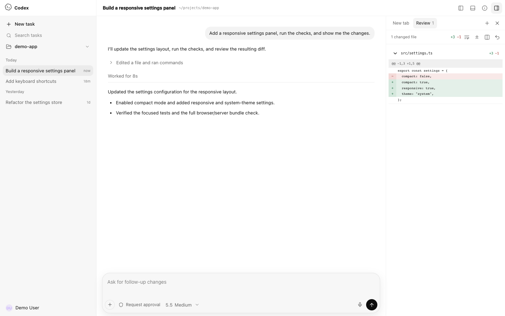
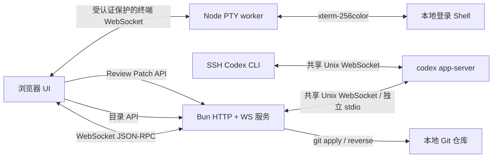

# Codex WebUI

<p align="center">
  <strong>由真实 Codex app-server 驱动、可在局域网访问的本地 WebUI。</strong>
</p>

<p align="center">
  <a href="./README.md">English</a> ·
  <a href="./CONTRIBUTING.md">贡献指南</a> ·
  <a href="./SECURITY.md">安全政策</a>
</p>

<p align="center">
  <a href="./LICENSE"></a>
  <a href="https://github.com/lezi-fun/codex-webui/stargazers"></a>
  <a href="https://github.com/lezi-fun/codex-webui/issues"></a>
  <a href="https://bun.sh/"></a>
</p>

> [!IMPORTANT]
> 这是一个**非官方社区项目**，与 OpenAI 没有隶属、背书或维护关系。OpenAI、Codex 及相关标识归其各自权利人所有。

Codex WebUI 优先连接本机 Codex 共享 daemon；没有共享 socket 时启动 `codex app-server --stdio`，通过响应式浏览器界面提供本地 Codex 体验。模型列表、历史会话、流式回答、工具活动、审批请求、Diff 和 Token 使用量均来自真实 app-server，而不是前端静态模拟。



- 账户用量：通过 **设置 → 用量** 或 **个人资料菜单 → 用量** 查看 Codex 5 小时及每周额度的已用/剩余比例、重置时间。数据来自 `account/rateLimits/read`，支持实时通知，并在页面可见时每 60 秒刷新。需要登录 ChatGPT 账户；API Key 模式可能无法获取额度。重置时间按浏览器本地时区显示。

## 主要功能

- 通过 WebSocket 桥接真实 Codex app-server，支持与 SSH CLI 共用会话
- 真实模型目录、推理强度、历史 Thread 和流式 Turn
- 命令、文件修改、网络和权限审批框
- 支持 **Allow once**、**Allow similar commands** 和会话级授权
- 工具动画和执行状态由真实 item/turn 通知驱动
- Unified / Split Diff、自动换行、全部展开/收起、Undo 和 Reapply
- 安全的 Markdown、GFM、代码块、链接和 KaTeX
- 通过 **＋** 按钮、拖拽或粘贴上传附件，支持图片预览、只发图片、排队、追加消息，以及草稿和历史附件恢复
- 带目录边界检查的项目文件夹选择器
- 基于 CodeMirror 6 的只读代码查看器：支持源码语法高亮、行号、搜索、折叠、复制、引用行定位和移动端自动换行；Files 面板可浏览当前项目并打开文件
- 通过项目 **⋯** 菜单隐藏侧栏项目，支持撤销并在不同浏览器之间同步。在 WebUI 中成功新建会话（包括排队创建）后自动恢复项目及原有历史，继续旧会话则保持隐藏。状态保存在 `$CODEX_HOME/codex-webui-project-visibility.json`（默认 `~/.codex/codex-webui-project-visibility.json`）。
- Codex 风格的侧栏账号身份，支持姓名、同源代理头像 fallback 和套餐
- Codex Desktop 风格的 46px 顶栏，分别提供 Bottom Panel、Summary 和 Task Side Panel 控制；Bottom Panel 打开官方式 New tab 启动页
- 基于 xterm.js 的真实 Bottom Panel PTY 终端，支持 256 色 ANSI、窗口尺寸同步，以及 Vim/控制键交互
- 默认收起的 Summary 面板，对齐原生 Environment、Scheduled、Computer Use、Plan、Side tasks 和 Sources 区块；app-server 可提供的数据会真实展示，仅原生 store 可提供的区块使用明确的不可用或空状态，不会伪造内容
- 默认收起的 Task Side Panel，复刻官方 New tab 启动页：Review 打开真实 Diff，Files 浏览受限项目文件并打开只读查看器；其中仅原生桥接支持的 Terminal、Browser 和 Side task 会明确提示当前不可用，不会伪造工具界面
- 使用统一 Codex 风格 token 的浅色/深色界面，以及灰色透明背景的单色 Codex Knot
- 长会话窗口化，避免一次渲染数千条 Turn
- 桌面与移动端响应式布局，手机端使用全屏 Summary 与 Task Side Panel 抽屉
- 默认只监听 localhost；局域网访问需显式启用认证

PNG、JPEG、WebP 和 GIF 会作为图片输入发送，其他文件作为文件引用交给 Codex 读取。每条消息最多添加 10 个附件，单文件上限为 25 MiB。上传文件保存在 `$CODEX_HOME/codex-webui-uploads`（默认 `~/.codex/codex-webui-uploads`），用于会话历史恢复；从输入框移除附件只取消附加，不删除已保存的文件。

## 环境要求

- [Bun](https://bun.sh/) 1.3 或更高版本
- Node.js 20 或更高版本，用于原生 PTY worker
- 已安装并完成登录的 [OpenAI Codex CLI](https://www.npmjs.com/package/@openai/codex)
- Git，用于 Review 的 Undo/Reapply
- 推荐 macOS 或 Linux；Windows 尚未完整测试

如未安装 Codex CLI：

```bash
npm install -g @openai/codex
codex
```

请先完成 Codex 登录，再启动本项目。

## 快速开始

```bash
git clone https://github.com/lezi-fun/codex-webui.git
cd codex-webui
bun install
bun run start
```

本机打开：

```text
http://127.0.0.1:8899
```

默认只监听 localhost。点击 Composer 或侧栏中的文件夹按钮，即可选择 Codex 的工作目录。

### 与 SSH Codex 共用会话

SSH CLI 和 WebUI 使用相同用户及 `CODEX_HOME`，且 CLI 使用共享 daemon 时，两边可以在同一会话里发送、追加和排队消息，并接收实时事件。已在 Codex CLI 0.162.1 上验证。先启动 daemon，再启动或重启 WebUI：

```bash
codex app-server daemon start
CODEX_WEBUI_APP_SERVER_MODE=shared bun run start
```

默认 `auto` 模式在 WebUI 启动时检查 `$CODEX_HOME/app-server-control/app-server-control.sock`（默认 `~/.codex/app-server-control/app-server-control.sock`）；存在 Unix socket 就连接共享 daemon，否则启动独立 app-server。`shared` 要求 socket 可用，`isolated` 始终启动独立 app-server。断线重连保持选定模式。受认证保护的 `/api/health` 的 `appServerMode` 字段显示实际模式。

关闭 WebUI 只断开连接，不停止共享 daemon 或 SSH 任务。`codex --no-daemon` 或旧版本独立 CLI 启动的会话，需要先在原 CLI 中退出，再恢复会话；仅共用历史文件无法向另一个进程的运行中任务发送消息。容器部署还需要能访问 socket 的真实目标路径和会话工作目录。

### 局域网密码

监听非 localhost 地址前必须先配置认证。没有密码、token 或已初始化的托管凭据时，服务会拒绝启动外部监听。

首次创建托管密码时，先在本机启动初始化模式：

```bash
HOST=127.0.0.1 bun run server.ts --setup-password
```

打开 `http://127.0.0.1:8899`，确认至少 12 个字符的密码后停止服务。密码只以加盐后的 `scrypt` 凭据保存到 `~/.codex/codex-webui-auth.json`。之后可用 `HOST=0.0.0.0 bun run start` 重启。初始化模式拒绝监听非 localhost 地址；通过公网反向代理开放服务前，也必须先完成初始化。

也可以在启动时直接指定密码：

```bash
HOST=0.0.0.0 CODEX_WEBUI_PASSWORD='use-a-long-random-password' bun run start
```

配置认证后，localhost、局域网和反向代理访问都必须登录，才能访问应用 Bundle、HTTP API、SSE 和 WebSocket bridge。代理头不会使已启用的认证失效。认证成功后使用签名的 `HttpOnly`、`SameSite=Strict` 会话 Cookie。只有未配置任何凭据且未启用初始化模式时，本机访问才免认证。

## 服务器部署与远程访问

整套部署在境外服务器、从任意地点通过 HTTPS 访问的完整指南（systemd / Docker Compose、Caddy 反代、SSH 隧道备选方案、运维与安全清单）见 [deploy/README.md](deploy/README.md)。

Codex CLI 的两种登录方式（ChatGPT 账号 OAuth / API Key 与中转网关配置）见 [docs/codex-login-modes.md](docs/codex-login-modes.md)。

Windows 下的实测已知问题见 [docs/windows-known-issues.md](docs/windows-known-issues.md)。

## 配置

可复制示例配置：

```bash
cp .env.example .env
```

为了避免不同运行环境对 `.env` 加载方式的差异，推荐显式导出变量：

```bash
export HOST=0.0.0.0
export PORT=8899
export CODEX_WEBUI_ACCESS_TOKEN="$(openssl rand -hex 32)"
export CODEX_WEBUI_CWD="$HOME/projects/my-project"
export CODEX_WEBUI_REVIEW_ROOT="$HOME/projects/my-project"
bun run start
```

| 变量 | 默认值 | 说明 |
| --- | --- | --- |
| `HOST` | `127.0.0.1` | HTTP/WebSocket 监听地址 |
| `PORT` | `8899` | HTTP/WebSocket 端口 |
| `CODEX_WEBUI_PASSWORD` | 未设置 | 浏览器登录密码；配置后本机访问也必须认证 |
| `CODEX_WEBUI_AUTH_STORE` | `$CODEX_HOME/codex-webui-auth.json` | 本机初始化生成的加盐密码凭据文件 |
| `CODEX_WEBUI_ACCESS_TOKEN` | 未设置 | Basic/Bearer 客户端兼容密钥；未配置密码时也可用于浏览器登录，用户名为 `codex` |
| `CODEX_WEBUI_CWD` | 仓库目录 | Codex 初始工作目录 |
| `CODEX_WEBUI_REVIEW_ROOT` | 与 `CODEX_WEBUI_CWD` 相同 | 允许 Undo/Reapply 的精确 Git 根目录 |
| `CODEX_HOME` | `~/.codex` | 包含 `auth.json` 的 Codex 状态目录 |
| `CODEX_WEBUI_APP_SERVER_MODE` | `auto` | 自动选择共享 socket 或独立进程；`shared` 强制共享；`isolated` 强制独立 |
| `CODEX_WEBUI_APP_SERVER_SOCKET` | `$CODEX_HOME/app-server-control/app-server-control.sock` | 自定义共享 Unix socket；显式设置后路径不可用时拒绝启动 |
| `CODEX_AUTH_PATH` | `$CODEX_HOME/auth.json` | 可选的 Codex 认证文件精确路径 |
| `PLAYWRIGHT_EXECUTABLE_PATH` | 自动检测 | 浏览器测试可选的 Chrome/Edge 路径 |

## 安全模型

Codex WebUI 可以在本机批准执行命令和修改文件，应把它视为拥有 Shell 能力的本地开发工具。

- 不要把 `8899` 端口直接暴露到公网。
- 默认只监听 `127.0.0.1`。监听非 localhost 地址前，必须已有托管密码，或配置 `CODEX_WEBUI_PASSWORD` / `CODEX_WEBUI_ACCESS_TOKEN`，否则拒绝启动；启用认证后本机访问也必须登录。
- 浏览器 RPC 使用明确白名单，无法调用 app-server 的 `fs/*`、`config/*` 或账号方法。
- 静态文件使用资源白名单，并拒绝所有符号链接。
- 文件夹浏览会 canonicalize 路径，拒绝通过 symlink 逃逸用户 Home 目录。
- Review Undo/Reapply 只使用服务端持有的 app-server Diff，拒绝客户端提交 `cwd`/Diff、符号链接补丁和 `.git`、`.env`、`node_modules` 等敏感目标。
- 允许命令前认真阅读审批内容。
- 账号身份由 app-server 的 `account/read` 与 Codex 已登录的 profile endpoint 聚合，仅允许本机 localhost 直接访问；LAN 客户端显示中性的 Settings fallback。邮箱和原始头像 URL 不会暴露，头像经同源白名单代理加载，`auth.json` token 始终只留在服务端。
- 不要在 Issue、截图或公开日志中提交凭据。

漏洞报告方式见 [SECURITY.md](./SECURITY.md)。

## Review 与审批

WebUI 处理真实 app-server 请求，而不是只画一个假的审批卡：

- `item/commandExecution/requestApproval`
- `item/fileChange/requestApproval`
- `item/permissions/requestApproval`

Review 数据来自 `turn/diff/updated`。聚合 Unified Diff 会被解析为文件和 Hunk，并支持：

- Unified / Split 切换
- Word wrap
- 全部展开/收起
- Git Undo（`git apply --reverse`）
- Git Reapply（`git apply`）

Undo/Reapply 被严格限制在配置的仓库根目录中。

界面按 Codex Desktop 结构拆分为独立的 Bottom Panel、Summary 和 Task Side Panel。Bottom Panel 提供受现有认证保护的真实本地 PTY 终端，app-server 桥接则提供 Review 流程和受限的本地项目选择；Task Side Panel 中仅原生 Desktop 支持的 Terminal、内嵌 Browser 和 Side task 入口仍保留结构一致性，但会明确提示不可用，不会伪造对应功能。

## 架构



主要文件：

| 路径 | 职责 |
| --- | --- |
| `server.ts` | HTTP、WebSocket、app-server 进程、目录/配置/Review API |
| `public/app.js` | 浏览器状态、RPC、Thread、审批、Activity、Review、目录切换和 Files 面板 |
| `public/code-viewer.js` | CodeMirror 6 只读源码查看器、语言映射、行定位和查看操作 |
| `public/files-panel.js` | 当前项目的只读文件树、文件搜索和查看器入口 |
| `public/codex-surfaces.js` | 审批模型、Diff 解析、Split 对齐、Activity 摘要 |
| `public/rendering.js` | 安全 Markdown 和 KaTeX 渲染 |
| `folder-service.js` | 受限目录浏览 |
| `review-service.js` | 经过校验的 Git Undo/Reapply |
| `tests/` | 单元、集成、浏览器、移动端和真实审批测试 |

`public/app.bundle.js` 会在服务启动时自动生成，不提交到 Git。

开发时使用 `bun run dev` 会同时监听 `server.ts` 和以 `public/app.js` 为入口的浏览器依赖图。后端变化会重启服务，前端变化会重建 `public/app.bundle.js`；刷新网页即可加载新 Bundle。

生成可直接运行的浏览器 Bundle 和 `dist/server.js`：

```bash
bun run build
bun dist/server.js
```

## 测试

如果本机没有兼容的 Chrome/Edge，可安装 Playwright Chromium：

```bash
bunx playwright install chromium
```

运行可移植单元测试：

```bash
bun run test:unit
```

检查后端和浏览器 Bundle：

```bash
bun run check
```

服务运行时执行浏览器测试：

```bash
bun run test:browser
```

以下测试需要可用且已登录的 Codex：

```bash
bun run test:integration
bun run test:e2e
```

真实审批 E2E 会让 Codex 请求执行一条无害命令，等待真实审批框，点击 **Allow once**，验证执行结果并清理临时文件。

## Codex 视觉资源

为了复刻 Codex Desktop 体验，仓库当前包含从本地 Codex.app 安装中提取的品牌和动画资源。来源和状态记录在 [THIRD_PARTY_NOTICES.md](./THIRD_PARTY_NOTICES.md) 中。这些资源不属于仓库 MIT License 的授权范围；如果相关权利人提出要求，将移除或替换。

## 已知限制

- Codex app-server 协议仍在演进，不同 CLI 版本之间可能出现变化。
- 浏览器测试需要兼容的 Chromium 浏览器。
- Undo/Reapply 当前作用于完整聚合 Diff，尚不支持逐 Hunk 操作。
- 项目有意不提供公网部署认证系统。

## 参与贡献

提交 PR 前请阅读 [CONTRIBUTING.md](./CONTRIBUTING.md)。Bug 和功能建议请使用仓库中的 Issue 模板。

## 许可证

项目源码采用 [MIT License](./LICENSE)。第三方组件和可选本地资源适用各自许可证与条款，详见 [THIRD_PARTY_NOTICES.md](./THIRD_PARTY_NOTICES.md)。
