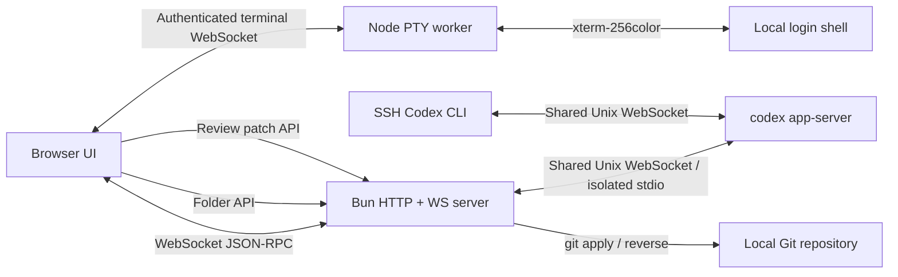

# Codex WebUI

<p align="center">
  <strong>A local, LAN-accessible WebUI for the real Codex app-server.</strong>
</p>

<p align="center">
  <a href="./README-zh.md">简体中文</a> ·
  <a href="./CONTRIBUTING.md">Contributing</a> ·
  <a href="./SECURITY.md">Security</a>
</p>

<p align="center">
  <a href="./LICENSE"></a>
  <a href="https://github.com/lezi-fun/codex-webui/stargazers"></a>
  <a href="https://github.com/lezi-fun/codex-webui/issues"></a>
  <a href="https://bun.sh/"></a>
</p>

> [!IMPORTANT]
> This is an **unofficial community project**. It is not affiliated with, endorsed by, or maintained by OpenAI. OpenAI and Codex are trademarks of their respective owners.

Codex WebUI connects to the local shared Codex daemon when available, or starts `codex app-server --stdio`, and exposes the local Codex experience through a responsive browser interface. It keeps real threads, models, streaming responses, tool activity, approval requests, diffs, and token usage instead of simulating them in a static frontend.


- Account Usage page shows the Codex 5-hour and weekly quota percentages and reset times. Open **Settings → Usage** or **Profile menu → Usage**. Data comes from `account/rateLimits/read`, with live updates and a 60-second refresh while the page is visible. ChatGPT sign-in is required; API-key accounts may have no quota data. Reset times use the browser’s local timezone.

## Highlights

- Real Codex app-server bridge over WebSocket, including shared sessions with the SSH CLI
- Real model catalog, reasoning effort options, threads, and streaming turns
- Command, file-change, network, and permission approval surfaces
- Approval scopes such as **Allow once**, **Allow similar commands**, and session-level approval
- Tool activity states driven by real item/turn notifications
- Unified and split diff review, word wrap, expand/collapse, Undo, and Reapply
- Safe Markdown, GFM, fenced code blocks, links, and KaTeX rendering
- Browser attachments through the **+** button, drag and drop, or clipboard paste; image previews, image-only messages, queued messages, steering, and draft/history restoration
- Project-folder picker with restricted filesystem browsing
- Read-only CodeMirror 6 source viewer with syntax highlighting, line numbers, search, folding, copy, citation line navigation, and mobile wrapping; the Files panel browses the active project and opens files
- Hide sidebar projects from their **⋯** menu, with Undo and visibility shared across browsers. Successfully creating a session in WebUI, including through the queue, restores the project and its history; continuing an existing session keeps it hidden. Visibility is saved in `$CODEX_HOME/codex-webui-project-visibility.json` (default `~/.codex/codex-webui-project-visibility.json`).
- Codex-style sidebar account identity with display name, same-origin avatar fallback, and plan
- Codex Desktop-style 46px header with separate Bottom Panel, Summary, and Task Side Panel controls; the Bottom Panel opens its native-style New tab launcher
- Real Bottom Panel PTY terminal powered by xterm.js, with 256-color ANSI output, terminal resize, and interactive Vim/control-key support
- Collapsed-by-default Summary panel matching the native Environment, Scheduled, Computer Use, Plan, Side tasks, and Sources sections; app-server data is shown when available and native-store-only sections use explicit unavailable or empty states instead of fabricated content
- Collapsed-by-default Task Side Panel mirroring the native New tab launcher: Review opens the real diff, Files browses restricted project files and opens the read-only viewer, and its native-bridge-only Terminal, Browser, and Side task entries show an explicit availability notice instead of a simulated tool
- Light and dark surfaces driven by shared Codex-style color tokens, including the monochrome transparent Codex Knot
- Windowed long conversations instead of rendering thousands of turns at once
- Responsive desktop and mobile layouts with full-screen Summary and Task Side Panel drawers on phones
- Localhost-only by default; authenticated LAN access is opt-in

Attachments support PNG, JPEG, WebP, and GIF as image inputs. Other files are sent as file references for Codex to read. Each message accepts up to 10 attachments, with a 25 MiB limit per file. Uploads are stored under `$CODEX_HOME/codex-webui-uploads` (default `~/.codex/codex-webui-uploads`) and retained for conversation history; removing a composer attachment detaches it without deleting the saved file.

## Requirements

- [Bun](https://bun.sh/) 1.3 or newer
- Node.js 20 or newer, used by the native PTY worker
- [OpenAI Codex CLI](https://www.npmjs.com/package/@openai/codex), installed and authenticated
- Git, for Review Undo/Reapply
- macOS or Linux recommended; Windows has not been fully tested

Install Codex CLI if needed:

```bash
npm install -g @openai/codex
codex
```

Complete the Codex sign-in flow before starting this project.

## Quick start

```bash
git clone https://github.com/lezi-fun/codex-webui.git
cd codex-webui
bun install
bun run start
```

Open:

```text
http://127.0.0.1:8899
```

The default bind address is localhost. Use the folder button in the composer or sidebar to select the project Codex should work in.

### Share sessions with SSH Codex

When both clients use the same user and `CODEX_HOME`, and the SSH CLI uses the shared daemon, WebUI can send, steer, and queue messages in the same thread and receive live events. Verified with Codex CLI 0.162.1. Start the daemon before starting or restarting WebUI:

```bash
codex app-server daemon start
CODEX_WEBUI_APP_SERVER_MODE=shared bun run start
```

The default `auto` mode checks `$CODEX_HOME/app-server-control/app-server-control.sock` (default `~/.codex/app-server-control/app-server-control.sock`) at startup. An existing Unix socket selects the shared daemon; otherwise WebUI starts an isolated app-server. `shared` requires an available socket; `isolated` always starts a separate process. The selected mode stays fixed across reconnects. The authenticated `/api/health` endpoint reports it as `appServerMode`.

Closing WebUI detaches its connection without stopping the shared daemon or SSH tasks. Sessions started with `codex --no-daemon` or an older standalone CLI must exit the original CLI before resuming; sharing history files alone cannot send input to another process's active turn. Containers also need access to the socket's actual target path and the session's workspace paths.

### LAN password login

Configure authentication before listening outside localhost. Without a configured password, token, or managed credential, a non-localhost listener refuses to start.

To create a managed password, first run initialization on localhost:

```bash
HOST=127.0.0.1 bun run server.ts --setup-password
```

Open `http://127.0.0.1:8899`, confirm a password of at least 12 characters, then stop the server. Only a salted `scrypt` credential is stored in `~/.codex/codex-webui-auth.json`. You can then restart with `HOST=0.0.0.0 bun run start`. The initialization mode refuses non-localhost listeners. Complete initialization before making the service reachable through a public reverse proxy.

Alternatively, provide a password at startup:

```bash
HOST=0.0.0.0 CODEX_WEBUI_PASSWORD='use-a-long-random-password' bun run start
```

When authentication is configured, all clients, including localhost and reverse proxies, must authenticate before accessing the main application bundle, HTTP APIs, SSE, or WebSocket bridges. Proxy headers never grant a bypass for configured authentication. Successful login uses a signed `HttpOnly`, `SameSite=Strict` session cookie. Localhost remains usable without authentication only when no credential is configured and initialization mode is not active.

`CODEX_WEBUI_ACCESS_TOKEN` remains available for compatibility with Basic/Bearer clients. `CODEX_WEBUI_PASSWORD` takes precedence over both the managed password and access token for browser login. Set `CODEX_WEBUI_AUTH_STORE` to move the managed credential file.

## Server deployment

For running the whole stack on a remote server (systemd / Docker Compose, Caddy HTTPS reverse proxy, SSH tunnel alternative, operations and security checklist), see [deploy/README.md](deploy/README.md) (Chinese).

Codex CLI authentication options (ChatGPT OAuth / API key with custom gateways): [docs/codex-login-modes.md](docs/codex-login-modes.md) (Chinese).

Field-tested known issues on Windows: [docs/windows-known-issues.md](docs/windows-known-issues.md).

## Configuration

Copy the example file if you want custom settings:

```bash
cp .env.example .env
```

Bun does not automatically load every `.env` convention in all execution contexts, so exporting variables explicitly is the most predictable option:

```bash
export HOST=0.0.0.0
export PORT=8899
export CODEX_WEBUI_ACCESS_TOKEN="$(openssl rand -hex 32)"
export CODEX_WEBUI_CWD="$HOME/projects/my-project"
export CODEX_WEBUI_REVIEW_ROOT="$HOME/projects/my-project"
bun run start
```

| Variable | Default | Description |
| --- | --- | --- |
| `HOST` | `127.0.0.1` | HTTP/WebSocket bind address |
| `PORT` | `8899` | HTTP/WebSocket port |
| `CODEX_WEBUI_PASSWORD` | unset | Browser login password; required for localhost too when configured |
| `CODEX_WEBUI_AUTH_STORE` | `$CODEX_HOME/codex-webui-auth.json` | Salted managed password credential created by local initialization |
| `CODEX_WEBUI_ACCESS_TOKEN` | unset | Compatibility secret for Basic/Bearer clients and browser login when no password is configured; username `codex` |
| `CODEX_WEBUI_CWD` | repository directory | Initial Codex working directory |
| `CODEX_WEBUI_REVIEW_ROOT` | `CODEX_WEBUI_CWD` | Exact Git root allowed for Undo/Reapply |
| `CODEX_HOME` | `~/.codex` | Codex state directory containing `auth.json` |
| `CODEX_WEBUI_APP_SERVER_MODE` | `auto` | Automatically select a shared socket or isolated process; `shared` requires sharing; `isolated` forces a separate process |
| `CODEX_WEBUI_APP_SERVER_SOCKET` | `$CODEX_HOME/app-server-control/app-server-control.sock` | Custom shared Unix socket; an unavailable explicitly configured path fails startup |
| `CODEX_AUTH_PATH` | `$CODEX_HOME/auth.json` | Optional explicit Codex authentication file path |
| `PLAYWRIGHT_EXECUTABLE_PATH` | auto-detected | Optional Chrome/Edge path for browser tests |

## Security model

Codex WebUI can approve command execution and file changes on your machine. Treat it like a local developer tool with shell access.

- Do **not** expose port `8899` directly to the public Internet.
- The default listener is `127.0.0.1`. A non-localhost listener refuses to start without an existing managed password, `CODEX_WEBUI_PASSWORD`, or `CODEX_WEBUI_ACCESS_TOKEN`. Configured authentication applies to localhost too.
- Browser RPC uses an explicit allowlist and cannot invoke app-server `fs/*`, `config/*`, or account methods.
- Static serving uses an asset allowlist and rejects symbolic links.
- Filesystem browsing canonicalizes paths and rejects symlinks that escape the user's home directory.
- Review Undo/Reapply uses server-owned app-server diffs, rejects client-supplied `cwd`/diff data, symbolic-link patches, and sensitive targets such as `.git`, `.env`, and `node_modules`.
- Read approval prompts before allowing commands.
- Account identity combines app-server `account/read` data with Codex's authenticated profile endpoint. It is available only through direct localhost access; LAN clients receive the neutral Settings fallback. Email and raw avatar URLs are not exposed, avatars use a same-origin allowlisted proxy, and `auth.json` tokens remain server-only.
- Never paste credentials into issues, screenshots, or public logs.

See [SECURITY.md](./SECURITY.md) for the reporting policy.

## Review and approvals

The WebUI handles app-server requests instead of drawing fake approval cards:

- `item/commandExecution/requestApproval`
- `item/fileChange/requestApproval`
- `item/permissions/requestApproval`

Review data is driven by `turn/diff/updated`. Unified diffs are parsed into files and hunks, and the Review panel supports:

- Unified / Split view
- Word wrapping
- Expand / Collapse all
- Git-backed Undo (`git apply --reverse`)
- Git-backed Reapply (`git apply`)

Undo/Reapply is deliberately restricted to the configured repository root.

The shell mirrors Codex Desktop's separate Bottom Panel, Summary, and Task Side Panel controls. The Bottom Panel provides a real authenticated local PTY terminal, while the app-server bridge provides the Review flow and restricted local project selection. Native Desktop-only Task Side Panel Terminal, embedded Browser, and Side task tabs remain visible for structural parity but show a clear unavailable message instead of simulating those capabilities.

## Architecture



Main files:

| Path | Responsibility |
| --- | --- |
| `server.ts` | HTTP server, WebSocket bridge, app-server process, folder/config/review APIs |
| `public/app.js` | Browser state, RPC, threads, approvals, activity, Review, project selection, and Files panel |
| `public/code-viewer.js` | CodeMirror 6 read-only source viewer, language mapping, line navigation, and viewer actions |
| `public/files-panel.js` | Restricted project file tree, file search, and viewer entry point |
| `public/codex-surfaces.js` | Approval models, unified-diff parsing, split alignment, activity summaries |
| `public/rendering.js` | Sanitized Markdown and KaTeX rendering |
| `folder-service.js` | Restricted directory browsing |
| `review-service.js` | Validated Git Undo/Reapply operations |
| `tests/` | Unit, integration, browser, mobile, and real approval tests |

`public/app.bundle.js` is generated automatically when the server starts and is not committed.

During development, `bun run dev` watches both `server.ts` and the browser entry graph rooted at `public/app.js`. Backend changes restart the server, while frontend changes rebuild `public/app.bundle.js`; reload the page to use the new bundle.

Build the browser bundle and a runnable `dist/server.js`:

```bash
bun run build
bun dist/server.js
```

## Docker

The repository includes a Compose setup for a local container deployment. Set `CODEX_BIN` to an executable Codex CLI path before starting it; the path is mounted read-only into the container. The app starts in projectless mode by default and stores Codex state through the configured volume.

```bash
export CODEX_BIN="$HOME/.codex/packages/standalone/releases/VERSION/bin/codex"
export CODEX_WEBUI_REVIEW_ROOT="$HOME/projects/my-project"
docker compose up -d --build
```

The Compose example does not mount the host Docker socket. The image runs as the configured `PUID`/`PGID` user and receives runtime configuration through environment variables.

## Testing

Install Playwright's Chromium if you do not already have a compatible Chrome/Edge binary:

```bash
bunx playwright install chromium
```

Run the portable unit suite:

```bash
bun run test:unit
```

Check both Bun and browser bundles:

```bash
bun run check
```

With a running server:

```bash
bun run test:browser
```

Tests that require a working, authenticated Codex installation:

```bash
bun run test:integration
bun run test:e2e
```

The real approval E2E asks Codex to execute a harmless command, waits for the actual approval request, clicks **Allow once**, verifies the result, and cleans up its temporary file.

## Codex visual assets

The repository currently includes Codex-style brand and motion assets extracted from a local Codex.app installation to reproduce the desktop experience. Their source and status are documented in [THIRD_PARTY_NOTICES.md](./THIRD_PARTY_NOTICES.md). These assets are not covered by this repository's MIT license and may be removed or replaced if requested by the relevant rights holder.

## Known limitations

- The Codex app-server protocol is evolving and may change between CLI versions.
- Browser tests need a compatible Chromium browser.
- Undo/Reapply currently operates on the complete aggregated diff, not one hunk at a time.
- Authentication and public-Internet deployment are intentionally out of scope.

## Contributing

Please read [CONTRIBUTING.md](./CONTRIBUTING.md) before submitting a pull request. Bug reports and feature requests can be opened through the repository's Issue templates.

## License

Source code is available under the [MIT License](./LICENSE). Third-party components and optional local assets are covered by their own licenses and terms; see [THIRD_PARTY_NOTICES.md](./THIRD_PARTY_NOTICES.md).
