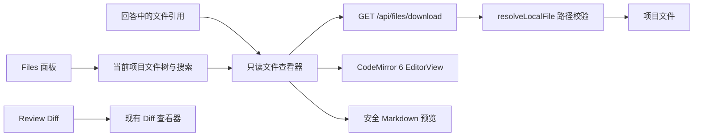

# CodeMirror 6 只读代码查看设计

本设计把 CodeMirror 6 作为 Codex WebUI 的源码查看内核，不把项目改造成完整 Web IDE。用户从回答中的文件引用或 Files 面板打开文件后，可以查看语法高亮、行号、折叠、搜索、复制和引用行定位；文件内容仍然只读，项目不新增保存、编译、运行或终端能力。现有 Markdown 预览、图片预览、PDF 预览和 Review Diff 保持各自的交互。

CodeMirror 6 由多个 `@codemirror/*` 包组成，官方文档列出移动端支持，当前项目应依赖 npm 发布包而不是已归档的 CodeMirror 5 仓库。[CodeMirror 官方网站](https://codemirror.net/)、[CodeMirror 只读配置](https://codemirror.net/docs/extensions/)

## 设计决定

| 决定 | 方案 |
| --- | --- |
| 查看内核 | CodeMirror 6 `EditorView`，通过 `EditorState.readOnly` 和 `EditorView.editable` 固定为只读 |
| 文件入口 | 现有文件引用直达查看器；右侧 Files 面板浏览当前项目 |
| 查看容器 | 复用现有 `dialog#filePreview`，源码区域替换为 CodeMirror，避免引入第二套窗口系统 |
| Markdown | 默认仍显示安全 Markdown 预览；Source 按钮切换到 CodeMirror |
| 文件读取 | 继续使用已认证的 `GET /api/files/download`，不增加写文件接口 |
| 文件树 | 增加只读的当前项目目录接口，目录按需展开，不返回工作区之外的内容 |
| 移动端 | 查看器全屏显示；默认自动换行，不自动聚焦编辑区域，避免打开软键盘 |
| 状态持久化 | 只保存查看偏好，不保存文件内容。当前打开文件、展开目录和请求状态留在内存中 |

## 当前代码与集成边界

当前 [public/file-preview.js](../../public/file-preview.js) 已经负责文件下载、文本解码、Markdown/源码切换、引用行高亮和关闭时清理；[public/app.js](../../public/app.js) 在文件引用点击时调用它；[server.ts](../../server.ts) 的 `/api/files/download` 通过 `resolveLocalFile` 校验 `cwd`、允许根目录、符号链接和文件大小后再读取文件。这些边界继续保留。

当前 Files 入口只显示“选择或切换项目目录”，没有项目内文件树。CodeMirror 集成不应把文件树逻辑塞进文件预览模块，而应增加一个受当前 `cwd` 限制的 Files 浏览器。这样项目切换仍由现有文件夹选择器负责，项目内查看则由 Files 面板负责。



## 用户体验设计

### 打开文件

文件有两个入口，打开结果一致：

1. 用户点击回答中的本地文件引用时，直接打开查看器，并定位到 `:lineStart-lineEnd`。现有引用语义不变。
2. 用户点击右侧面板的 Files，在当前项目中展开目录或搜索文件；点击文件名后打开查看器，从第一行开始显示。

查看器打开时先显示文件名、短路径和加载状态。请求完成后再创建 CodeMirror 实例，避免编辑器在隐藏或零尺寸容器中初始化。关闭、切换文件或请求过期时销毁旧的 `EditorView`，并恢复打开前的焦点。

### 桌面端布局

桌面端沿用现有右侧面板和居中的文件预览对话框：

```text
┌──────────────────────────────────────────────────────────────┐
│ app.js                                  Download       ×      │
│ ~/project/src/app.js:142                                    │
├──────────────────────────────────────────────────────────────┤
│ Preview  Source   Find   Wrap                         Read only│
├───────┬──────────────────────────────────────────────────────┤
│  140  │ const result = await request(...);                   │
│  141  │ if (!response.ok) throw new Error(...);               │
│▸ 142  │ return response.json();                               │
│  143  │                                                       │
└──────────────────────────────────────────────────────────────┘
```

- 标题区保留文件名、路径、Download 和关闭按钮。
- Markdown 文件显示 `Preview` / `Source`；其他文本文件默认显示 `Source`。
- `Find` 打开 CodeMirror 搜索面板；桌面端同时支持 `Ctrl/Cmd+F`。
- `Wrap` 切换自动换行，默认关闭，避免源码横向结构被改变。
- 右侧显示低强调度的 `Read only` 状态，不使用可编辑光标样式。
- 引用行使用左侧颜色条和整行背景色标记；范围较大时只标记范围，不改变文本选择。
- 文件过大、二进制、编码错误和读取失败沿用现有状态组件，不显示空白编辑器。

### 移动端布局

移动端不缩放桌面对话框，而是使用全屏查看器：

- 顶部保留返回/关闭按钮、短文件名和 Download；路径放到可横向滚动或截断的第二行。
- 工具栏允许横向滚动；`Find`、`Wrap` 和 `Copy` 使用图标按钮，并提供可访问名称。
- 默认启用自动换行，减少横向滚动；用户关闭 Wrap 后可以横向查看长行。
- 打开后焦点停留在关闭按钮，不主动聚焦 CodeMirror，防止 iOS/Android 弹出键盘；点击代码区域只进行滚动、选择和复制。
- `Esc`、返回按钮和浏览器返回（由页面已有导航策略处理）都应关闭当前查看器，不应误关闭底层 Files 面板。
- Files 面板在手机上占满视口，目录树和搜索结果单独滚动；打开文件后查看器覆盖 Files 面板，关闭后返回原来的目录和滚动位置。

### Files 面板

Files 面板继续使用现有 `sidePanel`，但将当前的占位工具页替换为项目浏览器：

- 面板标题为 `Files`，副标题显示当前项目短路径。
- 顶部提供文件名搜索框，输入后复用 `/api/files/search`；采用 180ms 防抖，结果最多显示 30 项。
- 未搜索时显示当前目录的懒加载树；目录点击展开/收起，文件点击打开查看器。
- 目录树每项显示文件名和相对路径，隐藏 `.git`、`node_modules`、`dist`、`build` 等目录。
- 当前文件使用轻量选中背景；不会在面板中同时创建多个编辑器标签。
- 没有活动项目时显示 `Choose project folder`，继续调用现有 `openFolderPicker()`。
- 目录为空、目录读取失败和结果截断都使用面板内状态，不通过 Toast 传递主要信息。

### 键盘、触摸和辅助功能

- 查看器使用现有 `dialog` 的焦点恢复机制；打开时聚焦关闭按钮，关闭后恢复触发入口。
- `Ctrl/Cmd+F` 调用 CodeMirror 搜索；`Esc` 先关闭搜索面板，再关闭文件查看器。
- CodeMirror 的 Tab 不应把页面焦点困在源码区域；查看器外的 Tab 顺序为 Download、工具栏、源码区域、关闭按钮。
- Files 树使用 `role="tree"`、`role="treeitem"`、`aria-expanded` 和 `aria-selected`；搜索结果使用 `role="listbox"`。
- 加载、错误和复制结果使用 `role="status"` 或 `aria-live="polite"`，不把完整路径重复朗读多次。
- 行号设置为装饰性内容，源码本身仍可被屏幕阅读器读取；选中行不能成为唯一的信息表达方式。
- 尊重 `prefers-reduced-motion`，CodeMirror 和查看器不增加持续动画。

## 前端组件设计

建议将查看器拆成一个小型适配层，避免把 CodeMirror API 扩散到页面状态：

### `public/code-viewer.js`

负责 CodeMirror 依赖、语言映射、主题、只读扩展、搜索、Wrap 和引用行装饰。

```js
createCodeViewer(container, {
  text,
  path,
  lineStart,
  lineEnd,
  wrap,
  theme,
  onCopy,
})
// => { focus, revealLines, setWrap, copy, destroy }
```

核心扩展组合：

```js
[
  basicSetup,
  languageSupport,
  search(),
  EditorState.readOnly.of(true),
  EditorView.editable.of(false),
  // 根据桌面/移动端 Wrap 状态条件启用 EditorView.lineWrapping
  引用行 decorations,
  项目主题与字体设置,
]
```

只读必须同时使用状态层和视图层配置。这样编辑命令不会修改文档，DOM 输入区域也不会表现为可编辑控件。查看器不注册保存监听器，也不向服务端发送文档变更。

### `public/file-preview.js`

继续负责：

- 请求生命周期和 `AbortController`。
- 2 MiB 文本上限、25 MiB PDF 上限和 UTF-8/控制字符校验。
- Markdown Preview/Source 切换。
- `EditorView` 的创建、替换和销毁。
- 过期请求保护，避免旧文件覆盖新文件。
- Download 链接、对话框关闭和焦点恢复。

源码模式不再逐行创建 `<span>`。行号、折叠、搜索和高亮全部交给 CodeMirror；只有引用范围使用装饰器表示。

### `public/files-panel.js`

负责 Files 面板的树状态、搜索、防抖、懒加载和打开文件回调。它不持有文件内容，也不直接调用 CodeMirror，只发送：

```js
openFile({ path: "src/app.js", cwd: "/workspace/project" })
```

`app.js` 负责把它接到现有 `filePreview.open()`，从而让引用入口和 Files 入口复用同一查看器。

### 语言映射

第一阶段只加载常用语言包，其他扩展名使用纯文本高亮，避免一次性加载所有语言：

| 文件类型 | CodeMirror 支持 |
| --- | --- |
| `.js`、`.jsx`、`.ts`、`.tsx` | JavaScript，按扩展名启用 JSX/TypeScript |
| `.json`、`.jsonc` | JSON |
| `.md`、`.markdown` | Markdown |
| `.py` | Python |
| `.css`、`.scss` | CSS；SCSS 可先回退 CSS |
| `.html`、`.htm`、`.vue` | HTML；Vue 单文件先按纯文本或 HTML 显示 |
| `.rs` | Rust |
| `.sql` | SQL |
| `.xml`、`.svg` | XML |
| YAML、Shell、Go、Java、C/C++ 等 | 第二阶段通过 `@codemirror/legacy-modes` 补充 |

第一阶段将常用语言包静态加入 Bun 浏览器 Bundle，避免动态 chunk 需要扩展现有静态资源白名单。语言包数量增加后，再单独设计带版本指纹的动态资源清单。

## 服务端接口设计

现有文件下载接口继续作为唯一的文件内容读取入口。Files 树增加：

```text
GET /api/workspace/tree?cwd=<active-cwd>&path=<relative-directory>
```

返回：

```json
{
  "cwd": "/workspace/project",
  "path": "src",
  "entries": [
    { "name": "components", "path": "src/components", "kind": "directory" },
    { "name": "app.js", "path": "src/app.js", "kind": "file", "size": 18240 }
  ],
  "truncated": false
}
```

服务端要求：

- `cwd` 必须在现有 `browseRoots` 和项目边界内。
- `path` 只解释为相对 `cwd` 的目录路径，拒绝 `..` 逃逸、绝对路径和 NUL 字符。
- 目录和文件都进行 `realpath` 校验，跳过符号链接。
- 目录项按目录优先、名称不区分大小写排序，单目录最多返回 200 项，并返回 `truncated`。
- 沿用搜索服务的跳过目录集合；接口只返回元数据，不返回文件内容。
- 接口仅允许 GET，使用现有认证和 `cache-control: no-store`。

该接口不能替代现有 `/api/files/search`。搜索仍用于快速定位文件，树接口用于没有关键词时的目录浏览。两者返回相同的相对路径格式，以便点击结果直接交给查看器。

## 状态与生命周期

查看器使用请求序号和 `AbortController` 管理竞态：

1. 打开新文件时递增 `requestId`，取消旧请求并销毁旧 `EditorView`。
2. 先校验响应、大小、UTF-8 和控制字符，再创建编辑器。
3. 对话框已关闭或 `requestId` 已过期时，丢弃结果，不更新 DOM。
4. CodeMirror 初始化后，在下一帧调用 `requestAnimationFrame`，再定位引用行并测量容器。
5. 关闭时销毁 View、清除装饰器和引用，释放请求；不在 `localStorage` 保存源码。

建议的内存状态：

```js
{
  requestId: 0,
  path: "",
  cwd: "",
  lineStart: null,
  lineEnd: null,
  language: "text",
  mode: "source",
  status: "idle", // idle | loading | ready | error
  error: "",
  editor: null
}
```

Files 面板单独维护 `cwd`、当前相对目录、展开目录集合和搜索请求序号。切换 Session 时，如果活动 `cwd` 改变，应清空展开目录和当前文件选中状态，避免把上一个项目的路径带到新项目。

## 性能、主题与安全

- 继续限制文本预览为 2 MiB 和 20,000 行；超限文件提供 Download，不尝试在浏览器中分页读取。
- CodeMirror 只在源码模式和查看器打开后加载；Markdown Preview 不创建编辑器。
- 关闭小地图、协同编辑、LSP、自动补全和诊断服务。当前目标是查看，不为用户制造“可以编辑或运行”的暗示。
- 主题使用项目已有的 `--app-*`、`--mono` 和深浅色状态，不直接依赖 CodeMirror 默认颜色；明暗主题切换时调用 `EditorView.theme` 对应的 compartment 重配置。
- 复制操作只读取当前文档或用户选区，不向服务端上传内容；Clipboard API 失败时显示可访问的手动复制提示。
- CodeMirror 的只读配置是 UI 约束，不承担文件授权。所有路径授权仍由 `/api/files/download` 和新树接口在服务端执行。
- 新增 npm 包后更新 `THIRD_PARTY_NOTICES.md`，保留 CodeMirror 的 MIT 许可和版权声明。

## 实施顺序

1. 增加 CodeMirror 6 核心包和第一阶段语言包，更新第三方声明，验证 Bun 浏览器 Bundle 和现有静态资源白名单。
2. 编写 `public/code-viewer.js`，先实现只读文本、主题、Wrap、搜索、引用行装饰和销毁。
3. 将 `public/file-preview.js` 的源码分支切换到 CodeMirror，保留 Markdown/PDF/错误路径。
4. 增加 `public/files-panel.js` 和 Files 面板 HTML/CSS；先接搜索，再接懒加载目录树。
5. 增加 `/api/workspace/tree` 和路径边界测试。
6. 完成桌面和移动端视觉调整、焦点管理、国际化文案和浏览器测试。
7. 在 README 中说明“只读代码查看”能力和大文件限制。

## 验收标准

### 查看器

- 从本地文件引用打开 `.js`、`.ts`、`.json`、`.py`、`.md` 时显示正确语言高亮。
- `:lineStart-lineEnd` 能定位并标记目标行；关闭后再次打开不会残留旧标记。
- 只读模式下键盘输入、粘贴、删除和格式化命令都不会改变内容。
- 搜索、Wrap、复制和 Download 在桌面与手机上可用。
- Markdown Preview/Source、PDF、图片和二进制错误行为保持不变。
- 旧请求不能覆盖新文件，关闭窗口后不会产生未处理异常或残留编辑器节点。

### Files 面板

- 当前项目目录可以按需展开，点击文件打开同一查看器。
- 搜索结果和树节点都使用相对当前项目的路径，切换项目后不会串目录。
- `.git`、`node_modules`、符号链接逃逸和越界路径不会出现在结果中。
- 未选择项目、空目录、读取失败和结果截断都有明确的空状态。

### 移动端与无障碍

- 720px 以下和触摸设备上查看器不产生页面横向溢出。
- iOS Safari 和 Android Chrome 中可以滚动、选择、复制和关闭查看器；打开源码不会自动弹出键盘。
- Files 树、工具栏、关闭按钮和状态消息具有可访问名称、焦点样式和正确 ARIA 状态。
- 浏览器返回、Esc 和关闭按钮不会破坏底层面板状态。

### 验证命令

```bash
bun run test:unit
bun run check
git diff --check
```

浏览器相关改动还需要运行文件预览、移动端布局和完整浏览器测试；重点覆盖 Chromium、Android Chrome 和 iOS Safari 的真实触摸交互。

